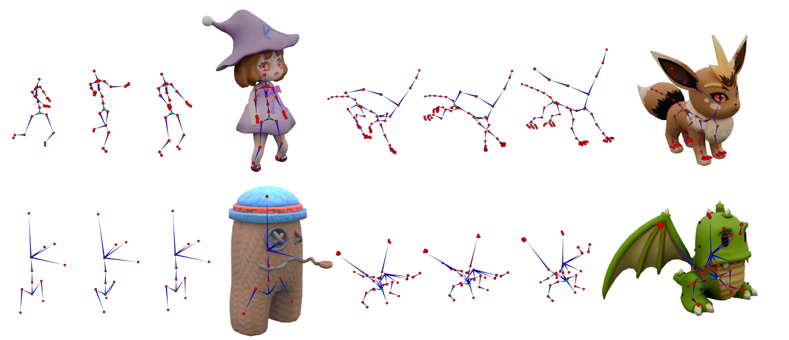

# SkelMo: Universal Skeletal Motion Generation for 3D Rigged Shapes

[Project page](https://research.davytao.me/skelmo/) · [Paper](https://arxiv.org/abs/2606.01518)

Official implementation of **SkelMo: Universal Skeletal Motion Generation for 3D Rigged Shapes**, accepted by ECCV 2026.

**Ye Tao, Yuxin Yao, Kendong Liu, Dapeng Wu, and Junhui Hou**

*City University of Hong Kong*



SkelMo generates category-agnostic skeletal animation for an arbitrary rigged 3D shape from a monocular driving video. It builds on a topology-agnostic diffusion backbone and introduces skinning-aware texture-semantic injection together with bidirectional video-skeleton fusion.

## Release status

- [x] Training and model code
- [x] Inference code for preprocessed inputs
- [x] Validated checkpoint inference code and input contract
- [x] Checkpoint bundle available
- [x] Skeleton preprocessing utilities and dense-DINO extraction from calibrated RGB frames
- [ ] Dataset assets (subject to their respective licenses)

## Installation

The code was developed with Python 3.8, PyTorch 2.4.1, and CUDA 12.1.

```bash
conda env create -f environment.yaml
conda activate skelmo
```

The first run downloads the DINOv2 ViT-B/14 weights through `timm`.

## Repository layout

```text
data_loaders/   SkelMo dataset and collation code
diffusion/      Diffusion process and sampling utilities
model/          Topology-aware SkelMo network
preprocess/     Rest-pose joint-feature preprocessing
sample/         Inference entry points
train/          Distributed training entry points
utils/          Skeleton preprocessing and common utilities
```

## Checkpoint

Download the [checkpoint bundle](https://drive.google.com/file/d/1ZJ4BKAkn4ms21tmoiNAxJtbXDT3GmKtZ/view?usp=sharing).
The 32-frame checkpoint uses calibrated first-frame joint projections
and a PCA128 dense-DINO video grid. For a new rig or driving video, inference
requires the aligned first-frame 3D skeleton, calibrated camera, and uncropped
frames; these are not inferred automatically. See the
[checkpoint inference guide](docs/CHECKPOINT_INFERENCE.md) for the
four-file checkpoint bundle, checksums, exact prepared-input schema, a tested
inference command, and the procedure for a new rig and driving video.

<details>
<summary>Optional rest-pose appearance checkpoint</summary>

This variant replaces only the per-joint appearance descriptors with merged
14-view rest-pose DINO features. It still conditions on the aligned **first
video frame** and uses the same calibrated 32-frame video input. Its separate
bundle is `skelmo_rest_merged_checkpoint_bundle.tar.gz` (SHA-256:
`fd089b83959af87a7c2a07847c83b283c31c771f94da09a04254b9f4c83dbcbd`);
the public download link will be added once hosted.

Use the [prepared-input contract](docs/CHECKPOINT_INFERENCE.md), adding
`rest_pose` (`[J,3]`, rest joints in the same camera frame) and
`rest_appearance` (`[J,768]`, 14-view DINO descriptors) to the NPZ in the
same joint order. Generate the descriptors with
[`preprocess.joint_features.pipeline`](preprocess/joint_features/README.md):
for each joint, select its `joint_max_weight_features.npy` descriptor, falling
back to `joint_averaged_features.npy`. Use only files produced by your own
trusted preprocessing run.

```bash
mkdir -p checkpoints
tar -xzf skelmo_rest_merged_checkpoint_bundle.tar.gz -C checkpoints
CUDA_VISIBLE_DEVICES=0 python -m sample.generate_checkpoint \
  --checkpoint checkpoints/skelmo_rest_merged/model000099999.pt \
  --stats checkpoints/skelmo_rest_merged/training_stats.json \
  --pca checkpoints/skelmo_rest_merged/pca_128.npz \
  --input /path/to/rest_prepared.npz \
  --frames-dir /path/to/uncropped_square_frames \
  --seed 2026 --guidance-scale 1 --output outputs/rest_example
```

</details>

## Validation

Run the preprocessing unit tests without Blender or model weights:

```bash
python -m unittest discover -s preprocess/joint_features/tests -v
```

## Training

The checkpoint was trained for 100,000 steps on random 32-frame
windows from a yaw-balanced dataset. It uses first-frame DINO joint features,
dense PCA128 video features, full spatial/temporal/reverse video attention,
fixed-residual fusion (scale 0.1), and pure conditional `l_simple` diffusion.
The processed training dataset is not part of this repository release. Consult
the checkpoint's `args.json` for the exact model configuration; do not assume
other training examples or input formats are compatible with these weights.

## Citation

```bibtex
@inproceedings{tao2026skelmo,
  title     = {SkelMo: Universal Skeletal Motion Generation for 3D Rigged Shapes},
  author    = {Tao, Ye and Yao, Yuxin and Liu, Kendong and Wu, Dapeng and Hou, Junhui},
  booktitle = {European Conference on Computer Vision (ECCV)},
  year      = {2026}
}
```

## Acknowledgements

This project builds on [AnyTop](https://anytop2025.github.io/Anytop-page/) and code derived from [Motion Diffusion Model](https://github.com/GuyTevet/motion-diffusion-model), OpenAI guided diffusion, GRPE, and Audiocraft. Visual representations use [DINOv2](https://github.com/facebookresearch/dinov2). Please also follow the licenses of the third-party projects and datasets used with this code.

## License

See [LICENSE](LICENSE). Third-party components and datasets remain subject to their own licenses.
